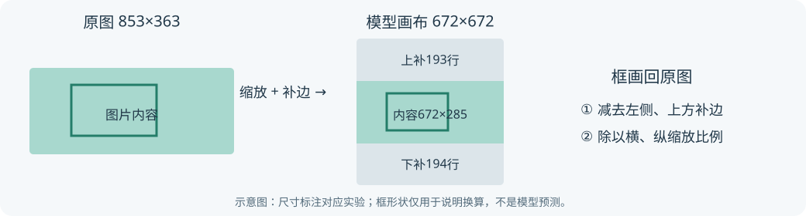

# J6 部署实验工具

地平线征程6部署实验中的小工具、使用说明和可复现样例。当前提供**检测框坐标还原工具**：图片保持比例缩放并补边之后，把模型坐标中的检测框还原到原图位置。

配套文章：[《检测框画偏了？把 J6 模型输出的位置还原到原图》](https://developer.horizon.auto/blog/14163)。实验于2026年10月12日在J6E MatrixB上完成，环境为OE 3.9.1、UCP 3.15.8、HBRT 4.11.11。

## 先看它解决什么

模型要求672×672输入，原照片可能是横图。预处理先缩小图片，再上下补灰边。模型返回的位置包含这些灰边，画回原图时必须先减补边、再除以缩放比例。



例如宽853、高363的原图，实际缩小为672×285，上方补193行、下方补194行。一个假设的模型纵坐标200，还原到原图约为8.9；漏减上方补边就会算成约254.7。

工具接收两个JSON文件：**实际变换记录**和**模型空间中的框**，输出原图坐标。它不执行模型推理，也不需要开发板。

## 下载与运行

可以使用Git克隆：

```bash
git clone https://github.com/Sam-Hui-dot/j6-deployment-tools.git
cd j6-deployment-tools/geometry_tool
python -m pip install -r ../requirements.txt
python map_boxes.py --record sample/transform.json --boxes sample/model_boxes.json --output restored.json
```

也可以在GitHub点击 **Code → Download ZIP**，解压后进入 `geometry_tool`，再执行安装依赖和运行命令。需要Python 3.9或更新版本，以及NumPy；实验与原样例复核使用的版本记录见[证据说明](geometry_tool/evidence/README.md)。

结果写入新的 `restored.json`。同一案例的保存参考是 `sample/restored_boxes_reference.json`。输出文件已存在时工具拒绝覆盖，第二次运行请换一个输出文件名。

## 仓库内容

| 目录/文件 | 用途 |
|---|---|
| [geometry_tool](geometry_tool/README.md) | 坐标还原命令、Python函数和完整使用说明 |
| `geometry_tool/sample` | 一组真实板端输出解码后的框、变换记录及还原参考 |
| [geometry_tool/evidence](geometry_tool/evidence/README.md) | 28个构造视图的记录、汇总统计和来源说明 |
| `geometry_tool/test_geometry_transform.py` | 横竖图、取整补边、已知坐标等已有检查用例 |
| `docs/letterbox.svg` | 本仓库绘制的流程示意 |

当前仓库提供坐标工具。图片推理、性能测试和其他工具属于系列中的不同工作，不作为已实现功能列在这里。

## 适用范围

坐标按连续框边界处理，在换算期间保留浮点数。还原规则应与自己的真实预处理一致；缩放、裁剪、旋转或补边位置发生变化时，要同步记录对应变换。

本次实验使用8张原照片构造28个横、竖、方及不对称补边视图，保存板端输出后固定模型空间筛选/NMS，共比较111个框的逆变换。详见[实验统计](geometry_tool/evidence/README.md)。它检查的是位置换算，未用目标标注评价检测精度。

仓库只包含独立坐标代码、自有记录和数值样例；运行不依赖OE SDK。COCO原照片、模型权重、HBM、SDK库及完整板端raw不包含在本仓库。

## 许可与反馈

源码、说明与自有数值记录采用[MIT许可](LICENSE)。发现与实际预处理不一致的情况，可以在Issues中附图片尺寸、缩放尺寸、补边、输入框坐标和期望坐标；提供可复现数值即可。
