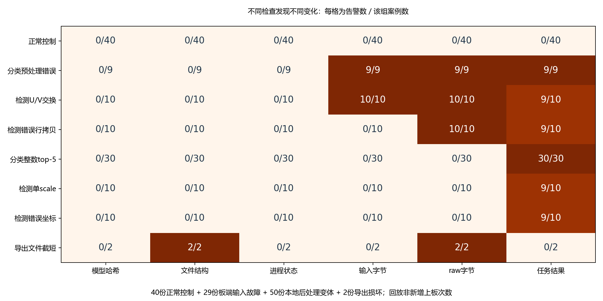

# 第八篇实验统计与来源

实验于2026年10月12日完成，环境为真实J6E MatrixB、OE 3.9.1、UCP 3.15.8、HBRT 4.11.11。

## 121例是什么

- 40例正常控制：30分类、10检测，来自真实板端结果。
- 29例真实板端输入故障结果：9分类预处理变化、10检测U/V交换、10错误行拷贝。
- 50例本地后处理变化：在真实raw上改30份分类整数排序、10份检测scale、10份坐标还原。
- 2例本地raw截短：分类与检测各一例。

统计是保存文件的离线回放，不是新增121次上板。

| 来源组 | 案例数 | 至少一层告警 |
|---|---:|---:|
| 正常控制 | 40 | 0 |
| 分类预处理错误 | 9 | 9 |
| 检测U/V交换 | 10 | 10 |
| 检测行拷贝错误 | 10 | 10 |
| 分类整数top-5排序 | 30 | 30 |
| 检测单scale | 10 | 9 |
| 检测错误拉伸坐标 | 10 | 9 |
| raw截短 | 2 | 2 |

合计正常40例全部通过，81个故障配置/损坏中79个告警。两例未告警均为正常结果本来就为空的后处理变化，不据此估计未知故障检出率。

## 文件

- `summary_121.json`：从原 `summary_v2.json` 直接提取汇总字段和分组统计。
- `coverage_v2.csv`：121例的逐例覆盖表，原文件保留。
- `baseline.json`：原40个固定模型/输入/raw/任务基准；只有数值和哈希，不含模型或输入文件。
- `fresh_board_summary.json`：另跑的一张分类、两张检测均通过；缺图案例真实进程退出1、检查器退出1。第一版框排列误报记录保留在原实验材料中，最终比较器为v2。
- `source_manifest.json`：原代码与证据文件的SHA-256和字节数，明确汇总JSON的提取关系。

完整模型、raw、输入、运行日志和旧失败记录保存在原实验材料中。本仓库不分发SDK/模型，亦未包含重放121例所需的全部文件；`../demo`的10例是额外整理的合成使用演示，不能计入实测成果。
